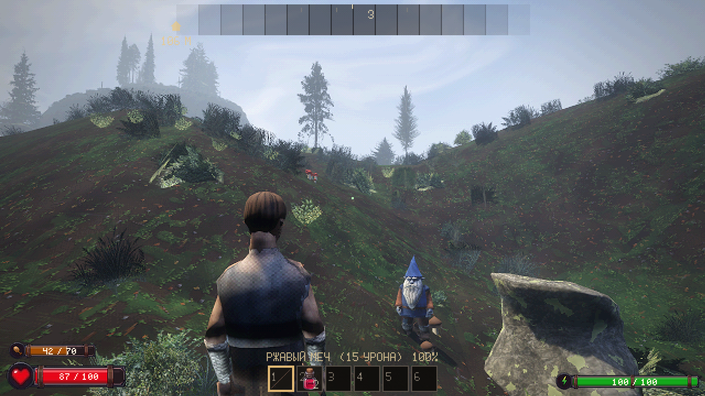
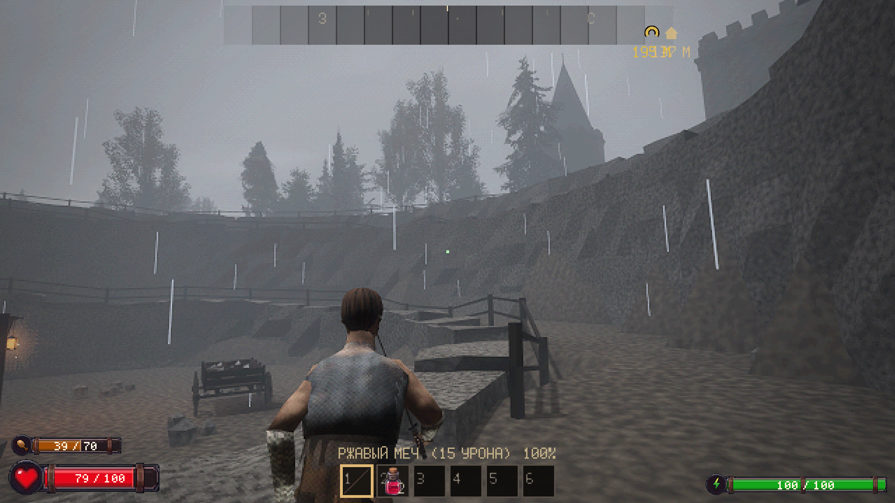
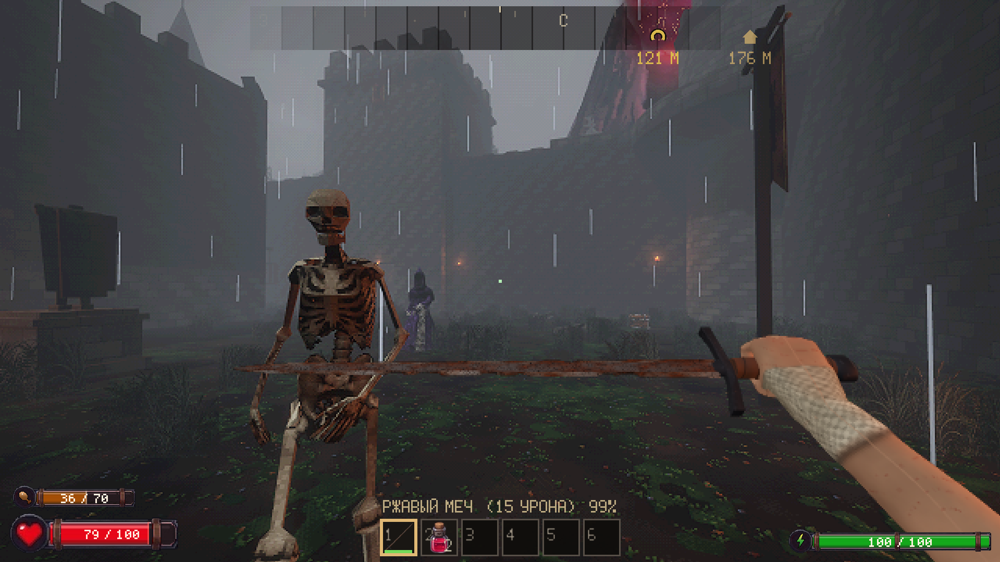
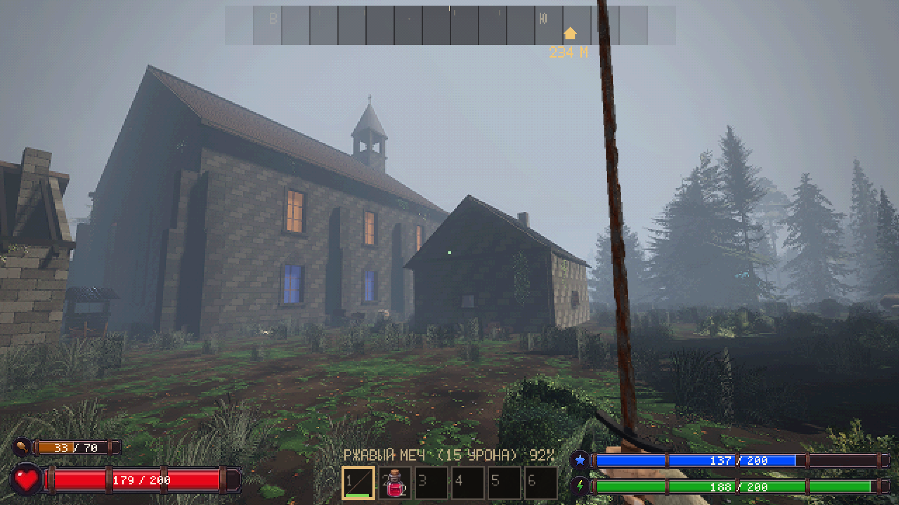

# Alderhold

**Ретро low-poly dark-fantasy extraction FPS.** Выбирайся из Убежища на проклятый остров, собирай добычу, сражайся с нежитью и возвращайся через люк, пока не грянуло Извержение. Тех, кто остался снаружи, Рой не щадит.

### [⬇ Скачать последнюю версию (Windows)](../../releases/latest)

## Мир

**Лес Альдерхолда.** Остров каждый раз генерируется заново: холмы, туманные овраги, озёра, руины и тропы между ними. По лесу бродят гномы-проводники, которые за 100 монет доведут куда угодно.

**Шахтёрские кратеры.** Заброшенные карьеры со спуском по спирали до самого дна. Там жилы железа, а изредка и Игниума. Наверху хижины шахтёров, телеги с рудой и сундуки.

**Враги.** Скелеты, культисты, зомби, лешие и боссы в своих логовах: Нечестивый Епископ, Павший Полководец, Могильщик со Старого кладбища. Бой построен на ударах, блоках, парированиях и пинках, а ещё есть магия.

**Деревни, замки, кладбища, пещеры и Пепельные горы.** Каждая вылазка ведёт на новую карту, и чем дальше заходишь, тем ценнее добыча и опаснее путь назад.

## Как скачать и запустить (Windows 10/11, 64-bit)

1. Открой **[Releases](../../releases/latest)** и скачай `Alderhold-Windows.zip`.
2. Распакуй архив в любую папку. Файлы `Alderhold.exe` и `Alderhold.pck` должны лежать рядом.
3. Запусти `Alderhold.exe`.

Если Windows покажет «Windows защитила ваш компьютер», нажми **Подробнее → Выполнить в любом случае** (сборка не подписана). Нужна видеокарта с поддержкой DirectX 12.

## Управление

WASD — ходьба, Space — прыжок, Shift — бег, C — присесть, Alt — отскок, ЛКМ — атака, Ctrl — блок / парирование,
ПКМ — заклинание, G — пинок, Q — бросок, E — взаимодействие, Tab — игровое меню, M — дневник, H — свист коню,
Esc — пауза (там же таймер до Извержения и номер вылазки).

## Кооп

Главное меню → «Создать сессию» (придумай 6-значный код) / «Присоединиться» (тот же код). Играть можно по локальной сети или через Radmin VPN / ZeroTier.

---

Это тестовая сборка, о багах пиши автору.
